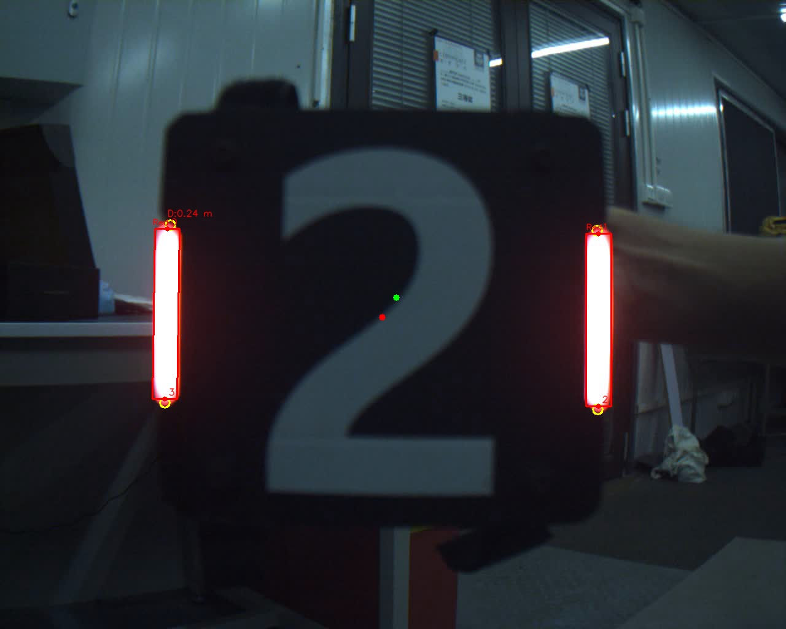
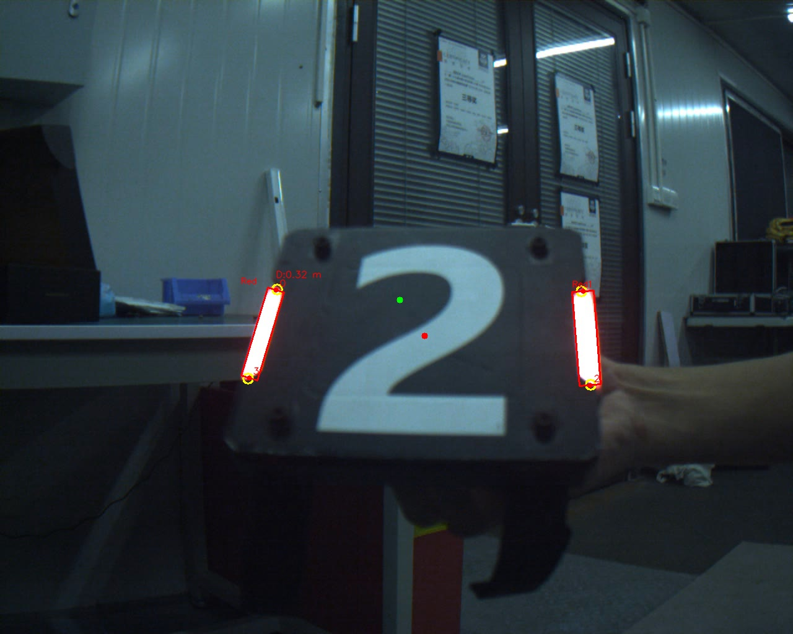

# Task4：Hello Armor

使用传统 OpenCV 完成视频逐帧灯条检测、红蓝颜色判断、装甲板配对、四端点提取和 PnP 测距。程序保留单文件处理流程，复用任务三的 `Light` 和 `Armor` 类。

## 文件结构

```text
task4/
├── CMakeLists.txt
├── video_read.cpp          读取、检测、配对、PnP、绘图和计时
├── data/
│   ├── README.md           原视频获取方法
│   ├── sources.json        素材与标定参数来源
│   └── LICENSE             原素材仓库许可证
└── results/                当前程序生成的演示、截图和检查记录
```

`Light`、`Armor` 的头文件与实现继续使用仓库中的 `task3/include/` 和 `task3/src/`。因此需要保留整个培训仓库的目录结构。Week5、Week6 保存学习练习，Task4 是本次任务提交入口。

## 环境与编译

依赖：C++17 编译器、CMake 3.16 及以上、OpenCV 4。检查环境为 WSL Ubuntu 22.04、g++ 11.4.0、CMake 3.22.1、OpenCV 4.5.4。

以下命令在仓库根目录运行：

```bash
cmake -S task4 -B task4/build -DCMAKE_BUILD_TYPE=Release
cmake --build task4/build --parallel 2
./task4/build/video_read /mnt/e/robomaster/school_training/hello_armor/video.avi
```

程序启动后，在终端输入 `Red` 或 `Blue`。课程样例中为红色装甲板，使用 `Red` 观察结果。窗口中的两个滑条分别调节亮芯阈值和红蓝色差阈值，按 `Esc` 退出。

程序支持在命令后指定一个视频路径；无参数时沿用本机 E 盘课程视频。换电脑时，可以先获取同一原视频：

```bash
curl --fail --location "https://raw.githubusercontent.com/TongjiSuperPower/sp_vision_tutorial_26/2bb6179ef9900bd1e5e815c287994d7357e62fe4/lecture4/class/video.avi" --output task4/data/video.avi
./task4/build/video_read task4/data/video.avi
```

原视频约 55 MB，由 `.gitignore` 排除；视频本身不放入 Git，下载位置和校验值见 [素材说明](data/README.md)。原视频的标定参数已保存在源码中。使用其他相机或经过缩放、裁剪的视频时，需要匹配的标定参数和物理尺寸。

## 处理流程

1. `VideoCapture` 逐帧读取，帧内候选重新创建。
2. `split`、`subtract`、`inRange` 生成红蓝色差掩膜和亮芯掩膜。
3. `findContours` 提取轮廓，通过面积、旋转矩形长宽比、倾角筛选灯条。
4. 在随灯条旋转的采样区域内判断红蓝颜色：短边扩大 3 倍、长边扩大 1.1 倍，生成局部多边形掩膜，再用 `bitwise_and` 限制红蓝像素统计范围。
5. 合格灯条保存为 `Light`，两两检查颜色、角度差、长度相似度、沿灯条的错位和横向间距，构造 `Armor`。
6. 根据两灯条中心、方向和长度，获得按左上、右上、右下、左下排列的四个端点。
7. `solvePnP` 使用四组对应点、相机内参与畸变系数求位置和朝向；画面显示 `norm(tvec)` 得到的米制直线距离。
8. `projectPoints` 把模型点投回图像，用黄色圆圈和检测端点比较；首次成功解算时打印四点平均重投影偏差。
9. 用 `getTickCount`、`getTickFrequency` 输出每帧处理耗时。

## 主要参数

| 参数 | 当前值与含义 |
| --- | --- |
| 最低亮度 | 默认 200；B、G、R 三个通道都达到门槛才属于亮芯 |
| 红蓝色差 | 默认 50；红比蓝、或蓝比红大于此值 |
| 最小轮廓面积 | 25 像素面积 |
| 灯条长宽比 | 2～15 |
| 灯条偏离竖直方向的倾角 | 不超过 60° |
| 两灯条角度差 | 不超过 22° |
| 短灯条长度 / 长灯条长度 | 不小于 0.6 |
| 沿灯条错位 / 横向间距 | 不超过 0.4 |
| 横向间距 / 平均灯长 | 1～4 |
| 红蓝颜色比例 | 有效色像素不少于 5 个；某颜色占比至少 60% |

当前保留了闭运算的学习代码，但未启用。配对分数有计算，尚未用它进行候选排序和冲突选择。颜色判断使用已有色差掩膜与旋转采样区域，没有额外引入主色通道亮度门槛。

## 相机参数与距离

相机内参、畸变系数和物理尺寸均来自同济课程同一示例：

- 原视频：1280×1024，30 FPS，752 帧，约 25.0667 秒。
- 两灯条中心线间距：0.135 米；灯条长度：0.056 米。
- 模型原点位于装甲板模型中心；四点顺序与图像端点顺序一致。
- `tvec` 的 Z 分量是前向深度；`norm(tvec)` 是相机光心到模型中心的直线距离。
- 黄色重投影圈用于检查图像吻合程度。当前打印的是四点欧氏偏差的平均值，单位为像素；低重投影偏差不能单独证明真实距离精度。

完整参数直接保存在 `video_read.cpp` 的视频循环之前，来源见 [sources.json](data/sources.json)。

## 耗时统计

终端逐帧输出 `Frame processing: ... ms`。计时从生成掩膜前开始，到本帧检测、PnP 和标注完成时结束，包含代码中间的掩膜窗口更新；不包含读帧、最终视频窗口更新、`waitKey(33)` 等待及随后打印耗时本身的开销。

该数值用于观察处理开销，不等于整套程序的播放帧率。首次成功求解的深度、距离和重投影偏差只打印一次。

## 效果演示与检查

[播放当前版本的 30 秒 MP4](results/demo_30s.mp4)






演示使用本次提交的检测流程生成：先播放完整的 752 帧，再以 `REPLAY` 标记重播开头 148 帧，共 900 帧、30 秒。重复部分只用于演示，不计入原片检查数据。演示生成时关闭交互窗口并使用默认红色参数。

本次检查使用当前默认参数（红色、亮度 200、色差 50）：

| 检查项 | 结果 |
| --- | ---: |
| 原视频处理帧数 | 752 |
| 有装甲板候选的帧数 | 729 |
| 有正深度 PnP 结果的帧数 | 729 |
| 同帧有多组候选的帧数 | 0 |
| 已求解候选四点平均重投影偏差的均值 | 2.94 像素 |

检查以关闭窗口和等待的导出副本处理完整原视频，检测、采样、配对与 PnP 运算沿用提交版本。以上计数表示候选和正深度解的出现次数，不等于人工标注的准确率或召回率。逐帧记录见 [frame_results.csv](results/frame_results.csv)，环境、源文件校验值和媒体检查见 [verification.json](results/verification.json)。

导出副本中的耗时不包含交互窗口更新，因此此表不把导出耗时当作原程序的窗口运行性能。原程序仍在终端逐帧输出自身的计时结果。

## 当前局限

- 素材是室内手持装甲板的课程示例，尚不能代表多种比赛场景。
- 无真实距离标注，尚未进行独立的实物测距精度验证。
- 阈值针对当前素材调试，强反光、模糊、遮挡、相邻同色目标仍可能产生漏检或误配。
- 使用固定小装甲板尺寸；当前未进行大小装甲板分类和跨帧滤波预测。

## 来源

- 同济 SP 26 培训仓库，固定版本 `2bb6179ef9900bd1e5e815c287994d7357e62fe4`。
- [课程原视频](https://github.com/TongjiSuperPower/sp_vision_tutorial_26/blob/2bb6179ef9900bd1e5e815c287994d7357e62fe4/lecture4/class/video.avi)。
- [课程相机参数与物理尺寸](https://github.com/TongjiSuperPower/sp_vision_tutorial_26/blob/2bb6179ef9900bd1e5e815c287994d7357e62fe4/lecture4/class/src/main.cpp)。
- 原素材仓库的 MIT 许可证保存在 [data/LICENSE](data/LICENSE)。
