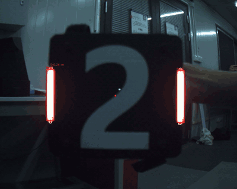
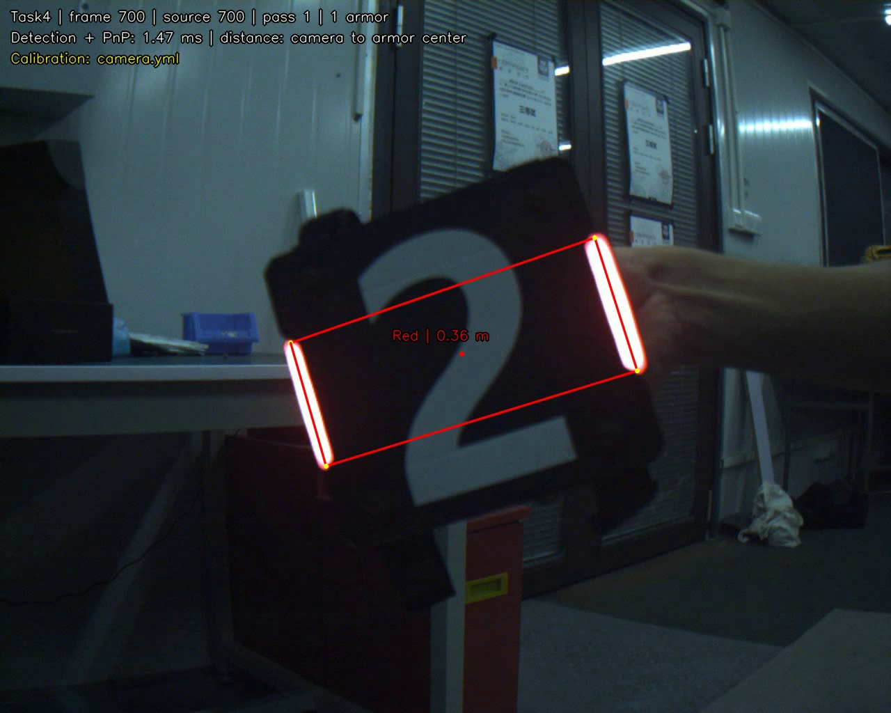

# Task4：Hello Armor

沿用 Week5 / Week6 的传统 OpenCV 灯条方案，完成视频装甲板配对、角点提取和 PnP 测距。复用任务三的 `Light` 与 `Armor` 类，用 CMake 构建。

本次按学习者确认，使用同济 SP 26 培训仓库的配套视频、相机内参和物理尺寸。素材是实验室手持红色 2 号装甲板的课程样例，不是实战比赛录像。下面的结果只描述这段样例。

## 编译与运行

依赖：Ubuntu、C++17 编译器、CMake 3.16+、OpenCV 4。Python 3 仅用于下载/校验素材，不参与检测。

从仓库根目录执行：

```bash
python3 task4/scripts/fetch_course_data.py
cmake -S task4 -B task4/build -DCMAKE_BUILD_TYPE=Release
cmake --build task4/build --parallel 2
./task4/build/hello_armor
```

素材脚本从固定版本的公开仓库下载视频并核对 SHA-256；当前电脑已有的相同素材也可直接复用。原视频约 55 MB，由 `.gitignore` 排除，换电脑后执行下载命令即可恢复。

画面显示四角点、装甲板框、中心点和距离；按 `Esc` 或 `q` 退出。终端默认每 30 帧打印该帧的处理耗时，结束后输出汇总；不打印候选轮廓和灯条列表。

## 文件与学习入口

| 文件 | 作用 |
| --- | --- |
| `main.cpp` | 读取参数，循环读帧，依次调用检测、解算和绘图，处理显示/保存。先从这里读。 |
| `include/armor_detector.hpp` | 筛选参数，以及灯条、装甲板检测结果的定义。 |
| `src/armor_detector.cpp` | `findLights` 找灯条，`identifyColor` 判断局部颜色，`matchLights` 配对。 |
| `include/pnp_solver.hpp`、`src/pnp_solver.cpp` | 读取标定配置，通过四组 3D-2D 对应点计算位置与距离。 |
| `config/camera.yml` | 相机内参、畸变参数、标定分辨率与装甲板物理尺寸。 |
| `tests/checks.cpp` | 检查旋转配对、颜色筛选、唯一配对、已知 PnP 位姿和异常角点。 |
| `data/` | 素材来源、许可证；下载的原视频也放这里。 |
| `results/` | 30 秒效果展示、截图、逐帧测量和验证说明。 |
| `docs/learning.md` | 知识点解释、与现有代码的对应关系、这次改动说明。 |

`build/hello_armor` 是最终运行程序；`build/task4_checks` 是检查程序；`build/libtask4_vision.a` 是构建时生成的公共代码静态库。`build/` 全部是自动生成的文件，不提交进仓库。

## 学校任务对应

| 要求 | 实现与证据 |
| --- | --- |
| OpenCV 4、读图、二值化滑条练习 | 保留在 [Week5](../week5/README.md)，其中 [Day7](../week5/src/day7.cpp) 可独立运行。 |
| 轮廓、外接矩形与灯条筛选，使用 Light | `ArmorDetector::findLights`，复用 `task3/include/light.hpp`。 |
| 灯条配对成 Armor，视频逐帧画框 | `matchLights` 和 `main.cpp`，每帧创建新的检测结果。 |
| 四个角点 solvePnP，画面显示距离 | `PnPSolver::solve`，有效解显示米制距离，失败时明确显示不可用。 |
| 30 秒效果视频或 GIF，放进 README | 下方视频及 GIF；原片尾部循环部分已在画面中注明。 |
| 大部分帧框中，终端输出单帧处理时间 | 原片 743/752 帧有检测结果，739 帧有有效 PnP；逐帧记录及耗时见 `results/`。 |

## 效果

[打开完整 30 秒 MP4](results/demo_30s.mp4)





原片为 1280×1024、30 FPS、752 帧（25.0667 秒）。展示视频先播放完整原片，再播放开头 148 帧，合计 900 帧、30 秒。第二遍显示 `REPLAY`，没有将重复播放计入原片验证数据。

完整原片检测记录（默认红色，亮度 150、色差 50）：

| 项目 | 结果 |
| --- | ---: |
| 解码帧数 | 752 |
| 有装甲板框的帧数 | 743 |
| 有有效 PnP 距离的帧数 | 739 |
| 同一帧出现多个框的帧数 | 0 |
| 检测与 PnP 平均耗时 | 约 1.62 ms/帧 |

这些计数表示检测输出频次，不等于准确率。已抽查不同距离和倾斜角度的画面，详细记录见 [验证说明](results/validation.md)。耗时不包括读帧、绘图、视频编码和窗口等待，也不代表整套程序的实时帧率。没有真实测距标注，不能由这些数据声称厘米级精度。

## 参数与调试

```bash
# 显示亮度掩膜和两个调参滑条；颜色统计也使用当前亮度与色差门槛。
./task4/build/hello_armor --tune=true

# 只检测蓝色，或使用其他阈值。
./task4/build/hello_armor --color=Blue --brightness=150 --difference=50

# 每帧打印处理耗时。
./task4/build/hello_armor --log-every=1

# 不弹窗，处理整个原片并保存结果；输出文件已存在时会拒绝覆盖。
./task4/build/hello_armor --headless=true --output=/tmp/task4_result.mp4 --csv=/tmp/task4_frames.csv

# 使用配套标定文件测试自己的同分辨率视频。
./task4/build/hello_armor /path/to/video.avi --camera=/path/to/camera.yml

# 从头循环，生成 30 秒展示。程序输出 mp4v 编码 MP4，可在本地播放器观看。
./task4/build/hello_armor --headless=true --seconds=30 --repeat=true --output=/tmp/task4_demo.mp4
```

提交的展示 MP4 已另行转为 H.264，以便网页播放。GIF 为同一段 30 秒展示的 440×352、5 FPS 预览；完整 MP4 保留 30 FPS。转换工具不属于检测程序的依赖。

## 相机与距离约定

`camera.yml` 的数值来自同一课程例程：标定分辨率 1280×1024、两灯条中心线间距 0.135 m、灯条长度 0.056 m。本项目使用统一的小装甲板尺寸；换大装甲板时需修改尺寸，大小装甲板混用则还需增加类型判断。

四角顺序固定为 **左上、右上、右下、左下**。图像点取自两根灯条长边中心线的端点，物体点为相同顺序的 `±宽度/2、±灯长/2、0`。

`solvePnP` 输出旋转向量 `rvec` 与平移向量 `tvec`。相机坐标 X 向右、Y 向下、Z 向前；画面显示 `sqrt(tx² + ty² + tz²)`，表示相机光心到装甲板中心的直线距离，单位米，`tz` 则单独表示前向深度。

仅接受有限数值、正 Z、四角重投影均方根误差不超过 5 像素的解。输入图像尺寸与标定尺寸不一致时会报错，避免静默套用错误内参。低重投影误差本身不能证明标定或物理尺寸正确。

## 检查

```bash
ctest --test-dir task4/build --output-on-failure
```

目前保留传统规则法：强遮挡、严重模糊、近邻同色装甲板和极端透视仍可能漏检或错配。后续收到新的比赛素材时，需要用对应标定重新验证。

## 来源

- 学校培养任务书第 3.2 节：Hello Armor。
- [同济 SP 26 培训仓库](https://github.com/TongjiSuperPower/sp_vision_tutorial_26)，固定版本 `2bb6179ef9900bd1e5e815c287994d7357e62fe4`。
- [课程原视频](https://github.com/TongjiSuperPower/sp_vision_tutorial_26/blob/2bb6179ef9900bd1e5e815c287994d7357e62fe4/lecture4/class/video.avi)及[相机参数与物理尺寸参考](https://github.com/TongjiSuperPower/sp_vision_tutorial_26/blob/2bb6179ef9900bd1e5e815c287994d7357e62fe4/lecture4/class/src/main.cpp)。许可证保存在 `data/LICENSE`，校验值见 `data/sources.json`。
- [OpenCV：轮廓与形状描述](https://docs.opencv.org/4.5.4/d3/dc0/group__imgproc__shape.html)、[形态学](https://docs.opencv.org/4.5.4/d9/d61/tutorial_py_morphological_ops.html)、[PnP](https://docs.opencv.org/4.x/d5/d1f/calib3d_solvePnP.html)。
